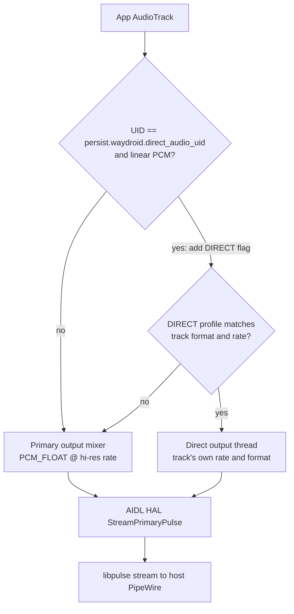
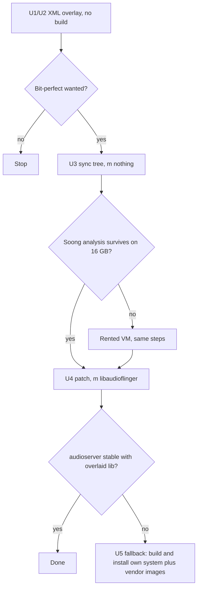

# Waydroid Hi-Res Audio on LineageOS 24 - Plan

**Target repos:**
- This folder (`fork-waydroid-hires`) holds the overlay files and the patch.
- A local LineageOS 24 checkout synced from the WayDroid-ATV manifest holds the source to build. Source paths below are relative to that checkout's root, for example `frameworks/av/...`.

---

## Goal Capsule

- **Objective:** On the WayDroid-ATV LineageOS 24 / Android 17 image (release 20261017, x86_64), music reaches the host's PipeWire at 24-bit/float and at hi-res rates instead of 16-bit at up to 48 kHz. Apple Music tracks also reach it untouched, at the track's own rate.
- **Means:** two vendor XML overlay edits with no build (KTD1, KTD2), then one patched system library, `libaudioflinger`, built from the tree and overlaid (KTD3, KTD4).
- **Authority:** the user's requirements (R-IDs) come first, then the KTDs, then the units.
- **Execution profile:** a local fork with no PRs. Changes ship as overlay files under `/var/lib/waydroid/overlay/` plus one patch kept in this folder.
- **Stop conditions:**
  - Stop after U1 if the user is happy with hi-res through the mixer and does not want bit-perfect.
  - Stop and report if Apple Music's track turns out not to be plain linear PCM (U3 pre-check). The U4 patch cannot reach such a track.
  - Stop and report if `m nothing` cannot finish on the host even with zram plus swap (U3). Then ask whether to rent a VM.
  - Stop and report if the overlaid `libaudioflinger` makes audioserver crash-loop and the full-image fallback (U5) is not wanted.
- **Who finishes:** the user runs the build and deploys on their own machine. An agent may prepare the overlay files and the patch.

---

## Product Contract

### Summary

Hi-res audio needs no build. The vendor policy XML that ships in the image is the HAL's only format list. Overlaying a copy that offers PCM_FLOAT at 44.1–192 kHz lets the mixer run at hi-res. A second overlaid mixPort with the DIRECT flag gives untouched output a place to go. Apple Music never asks for DIRECT on its own, so one small patch in `AudioFlinger::createTrack` adds the flag for a chosen app UID. That patch is the only part that needs building, and only `libaudioflinger` is built.

### Problem Frame

The original Reddit fix targeted Android 13's legacy `audio_hw.c`. WayDroid-ATV deleted that HAL on 2026-09-22 and replaced it with the AOSP AIDL HAL plus a PulseAudio backend (`hardware/interfaces/audio/aidl/default/pulse/`). The new backend already maps float32, 24-bit and 32-bit PCM to PulseAudio sample formats. The real limit now is that the shipped `primary_audio_policy_configuration.xml` offers only `AUDIO_FORMAT_PCM_16_BIT` at 8–48 kHz, and the HAL refuses anything outside the offered profiles. Apple Music's lossless and hi-res audio is therefore resampled and truncated. On a 16 GB host, rebuilding whole images is slow, so the fix should build as little as possible.

### Requirements

**Hi-res through the mixer**
- R1. With the overlay in place, the primary output runs at PCM_FLOAT at a hi-res rate, and every app's audio reaches the host at that format and rate.
- R2. System sounds, notifications and other apps keep playing normally through the primary output.

**Bit-perfect for one app**
- R3. Tracks from one user-chosen app UID play through a DIRECT output at the track's own sample rate and format, with no mixing or resampling inside Android.
- R4. Tracks from that UID that no DIRECT profile can serve still play, through the mixer.
- R5. The user can set or change the chosen UID without rebuilding.

**Build and deploy**
- R6. Only `libaudioflinger` is compiled. No system or vendor image is rebuilt unless the overlaid library fails to load (U5 fallback).
- R7. Every change can be undone by deleting overlay files and restarting the container.

### Key Decisions

- **Build it yourself, including the bit-perfect path for Apple Music.** Governs R3, R6. (session-settled: user-directed — chosen over asking the WayDroid-ATV maintainer to add hi-res profiles upstream: the user wants it working now, on their own build)

### Success Criteria

- With Apple Music playing a 24-bit/96 kHz track, `dumpsys media.audio_flinger` shows a DIRECT output thread at 96000 Hz, and PipeWire shows an "Android … @ 96000Hz" stream. The host's PipeWire must allow that rate.
- Plain YouTube or system audio still plays, through the hi-res primary output.

### Scope Boundaries

- Not covered: the legacy `audio_hw.c` HAL, the AUR `waydroid-apple-music` package, Android 13 images, and arm64.
- Not covered: Bluetooth, recording/input paths and telephony mixPorts. They stay as shipped.
- Not covered: Apple Music's Wi-Fi-only lossless gate. It is checked in verification, and if it fails the known workaround is `persist.waydroid.fake_wifi`. Fixing the gate in code is not in scope.
- Considered and not built: a retry inside the patch that drops DIRECT when `getOutputForAttr` fails (R4). The U4 test checks whether the policy manager already falls back to the mixer. Build the retry only if that test shows silence.
- Considered and not built: changing `Configuration.cpp`. It is only the fallback when the XML has no module, so it never applies here.

#### Deferred to Follow-Up Work

- Upstream the XML changes (U1, U2) to `WayDroid-ATV/android_device_waydroid_waydroid` lineage-24.0 `configs/`, so no overlay is needed.

---

## Planning Contract

### Key Technical Decisions

- KTD1. **The vendor XML is the format list.** The HAL's `main.cpp` builds every module except r_submix from `audio_policy_configuration.xml` through `AudioPolicyConfigXmlConverter`. audioserver takes its policy config from the HAL first (`AudioPolicyConfig::loadFromApmAidlConfigWithFallback`). One overlaid XML therefore changes the HAL and the policy together, with no build. Evidence: `hardware/interfaces/audio/aidl/default/main.cpp` and `AudioPolicyConfigXmlConverter.cpp` `init()` on WayDroid-ATV lineage-24.0.
- KTD2. **The primary output offers PCM_FLOAT plus PCM_16_BIT only.** Android's mixer works in float internally, and float is the format the new PulseAudio backend is sure to pass (`pulse/Utils.cpp` maps `FLOAT_32_BIT→PA_SAMPLE_FLOAT32`). Adding 24/32-bit integer to a mixed output gains nothing. 16-bit stays for compatibility. The DIRECT mixPort (KTD3) carries the integer formats.
- KTD3. **Bit-perfect uses a DIRECT mixPort, and Apple Music is pushed into it by a UID check in `AudioFlinger::createTrack`.** The policy manager sends linear PCM to a DIRECT output only when the client asks for `AUDIO_OUTPUT_FLAG_DIRECT`. The Android 14+ bit-perfect mixer API (`setPreferredMixerAttributes`) is limited to USB devices (`audio_is_usb_out_device` check in `AudioPolicyManager.cpp`) and needs the app to opt in. The patch sets the flag on `input.flags` before `AudioSystem::getOutputForAttr`, for linear-PCM tracks from the chosen UID. This matches the original Reddit fix's insertion point. (session-settled: user-directed — chosen over waiting for an upstream bit-perfect feature: the user asked for the direct path now)
- KTD4. **The UID comes from `persist.waydroid.direct_audio_uid`.** It is read in `createTrack`. The user sets it with `waydroid prop set` (R5). It replaces the original's `/data/local/tmp/apple_music_uid.txt`: no file I/O on the audio path, and no dependency on `/data/local/tmp` permissions.
- KTD5. **Build `libaudioflinger` in the full tree on the local host first.** The patched code lives in `frameworks/av`. It links many platform-internal libraries, so an out-of-tree NDK build is not workable. Soong analysis of the whole tree is unavoidable even for one module. The host gets 16 GB of lz4 zram plus a 32–48 GB swapfile and a reduced `-j`. A rented VM (for example a Hetzner CCX63, about €1.37/h) is the fallback only if `m nothing` cannot finish.

### High-Level Technical Design

Audio path after the change:

Build and deploy gates:

### Assumptions

- The policy manager opens the primary output at the highest offered sample rate, so the mixer rate is set by the largest rate listed in KTD2's profile. U1 verifies this.
- On the host, PipeWire's `default.clock.allowed-rates` includes the rates in use. Otherwise PipeWire resamples on the host side.
- Waydroid runs without SELinux enforcement, so audioserver can read `persist.waydroid.*` properties.

### Risks & Dependencies

| Risk | Mitigation |
|---|---|
| The overlaid `libaudioflinger` doesn't match the prebuilt 20261017 system image, because the branch heads have moved since the release. audioserver then crashes or fails to link. | Checked in U4. Fallback U5 builds matching system and vendor images from the same tree. Rollback is deleting one overlay file (R7). |
| StreamPulse's MonoPipe rejects a 24/32-bit integer format on the DIRECT port. | U2 lists PCM_FLOAT first, and U4 tests 24-bit content, which Apple Music delivers as float. If an integer format fails, drop it from the XML. |
| Android's volume slider doesn't change DIRECT output volume. | Accept it for bit-perfect output and control volume on the host. Note it in the verification results. |
| The `lunch` release token for LOS 24 is unknown. | Read it from the `lunch` menu during U3. The product name is `lineage_waydroid_x86_64` (`device/waydroid/waydroid/AndroidProducts.mk`). |

---

## Implementation Units

### U1. Hi-res primary output through the vendor XML overlay

- **Goal:** the mixer runs at PCM_FLOAT at a hi-res rate, with no build.
- **Requirements:** R1, R2, R7. KTD1, KTD2.
- **Dependencies:** none.
- **Files:** `overlay/vendor/etc/primary_audio_policy_configuration.xml`, copied from `device/waydroid/waydroid/configs/primary_audio_policy_configuration.xml` (lineage-24.0) and installed to `/var/lib/waydroid/overlay/vendor/etc/`.
- **Approach:**
  1. Copy the shipped file unchanged, so the diff stays reviewable.
  2. On the `primary output` mixPort, add a `AUDIO_FORMAT_PCM_FLOAT` profile at 44100, 48000, 88200, 96000, 176400 and 192000, in stereo. Keep the existing 16-bit profile.
  3. Leave the input, mmap and telephony ports untouched.
- **Execution note:** this is config only, so prove it with a runtime smoke check, not unit tests.
- **Patterns to follow:** the existing `<profile>` elements in the same file. The format names follow `system/media/audio/include/system/audio-base.h`.
- **Test scenarios:**
  - After a container restart, `dumpsys media.audio_flinger` shows the primary output thread with Format `AUDIO_FORMAT_PCM_FLOAT` and a sample rate above 48000.
  - While a YouTube video plays, the host's `pactl list sink-inputs` shows an Android stream at that rate and format `float32le`.
  - A notification sound and a media app play at the same time without crackling or dropouts.
  - Deleting the overlay file and restarting brings back the 16-bit/48 kHz primary output (R7).
- **Verification:** all four scenarios pass, and logcat shows no `AudioPolicyConfigXmlConverter` parse errors.

### U2. DIRECT mixPort for bit-perfect output

- **Goal:** the HAL and the policy offer a DIRECT output that can open at any common hi-res rate and format.
- **Requirements:** R3, R7. KTD1, KTD3.
- **Dependencies:** U1, the same file.
- **Files:** `overlay/vendor/etc/primary_audio_policy_configuration.xml`.
- **Approach:**
  1. Add a mixPort named `direct output`, role source, flags `AUDIO_OUTPUT_FLAG_DIRECT`. Give it profiles for PCM_FLOAT, PCM_24_BIT_PACKED, PCM_32_BIT and PCM_16_BIT at 44100–192000, in stereo.
  2. Add it to the Speaker route's sources.
- **Patterns to follow:** the existing `mmap_no_irq_out` mixPort and its route entry in the same file.
- **Test scenarios:**
  - After a restart, `dumpsys media.audio_policy` lists the `direct output` IOProfile with all four formats, and no HAL errors appear in logcat.
  - Normal playback from U1 still uses the primary output, because no app requests DIRECT yet.
- **Verification:** both scenarios pass. The DIRECT path is actually exercised in U4.

### U3. Build tree and host memory setup

- **Goal:** a synced LOS 24 WayDroid-ATV tree where Soong analysis finishes on the 16 GB host.
- **Requirements:** R6. KTD5.
- **Dependencies:** none. It can run while U1 and U2 are tested.
- **Files:** none in this folder. The setup lives on the host (zram, swapfile) and in the checkout's `.repo/local_manifests/`.
- **Approach:**
  1. Run `repo init` on LineageOS `lineage-24.0` with `--depth=1 --git-lfs`.
  2. Run `vendor/extra/manifest_scripts/generate-manifest.sh` from WayDroid-ATV `android_vendor_waydroid` lineage-24.0 to write the local manifests, then sync. This pulls `frameworks/av` from `WayDroid-ATV/android_frameworks_av` lineage-24.0.
  3. Apply the Waydroid patches as the vendor repo documents.
  4. Run `lunch` with `lineage_waydroid_x86_64`, the release token shown in the `lunch` menu, and `userdebug`.
  5. Before `m nothing`, enable 16 GB of lz4 zram plus a 32–48 GB swapfile. Leave at least 250 GB of disk free.
- **Execution note:** before syncing at all, play a hi-res track in Apple Music on the U1/U2 overlay. Read its track entry in `dumpsys media.audio_flinger`. Continue only if it is a plain linear-PCM track with no offload, MMAP or AAudio flags, because the U4 patch can only change that kind of track. Then run `m nothing` as the gate before any real build.
- **Test expectation:** none -- environment setup. The gate is that `m nothing` finishes.
- **Verification:** `m nothing` finishes without an OOM kill. If it can't, stop per the Goal Capsule and offer the rented-VM route.

### U4. Force DIRECT for the chosen UID in AudioFlinger

- **Goal:** linear-PCM tracks from the UID in `persist.waydroid.direct_audio_uid` request DIRECT output.
- **Requirements:** R3, R4, R5. KTD3, KTD4.
- **Dependencies:** U2 (a DIRECT profile must exist) and U3.
- **Files:**
  - Modify `frameworks/av/services/audioflinger/AudioFlinger.cpp` (`AudioFlinger::createTrack`).
  - Export the change to `patches/frameworks_av/0001-audioflinger-direct-output-for-uid.patch` in this folder, so it can be reapplied after `repo sync`.
- **Approach:**
  1. In `createTrack`, before the `AudioSystem::getOutputForAttr` call, read the property on every call. This is a cheap shared-memory read, and it means a UID change takes effect on the next track with no restart (R5). If the client UID matches and `input.config.format` is linear PCM, OR `AUDIO_OUTPUT_FLAG_DIRECT` into `input.flags`.
  2. Log one line naming the UID, format and rate, so verification can see that the patch fired.
  3. Build only `libaudioflinger`.
  4. Copy `out/target/product/waydroid_x86_64/system/lib64/libaudioflinger.so` to `/var/lib/waydroid/overlay/system/lib64/`.
- **Execution note:** prove it with a runtime smoke check. `frameworks/av` has no practical unit-test seam for `createTrack` policy, so the checks below are on the device.
- **Technical design:** directional only.
  `if uid == prop(persist.waydroid.direct_audio_uid, -1) and audio_is_linear_pcm(format): flags |= DIRECT`
- **Patterns to follow:** the `AudioSystem::getOutputForAttr` call inside `createTrack` itself. There, `input` is a local copy whose `flags` can be written, and the client UID is `adjAttributionSource.uid`. For reading the property, follow how existing code in `frameworks/av/services/audioflinger` reads properties.
- **Test scenarios:**
  - Set the property to Apple Music's UID (`dumpsys package com.apple.android.music | grep userId`) with no restart. The next 24-bit/96 kHz track then shows a DIRECT output thread at 96000 Hz in `dumpsys media.audio_flinger`, and PipeWire shows an "@ 96000Hz" Android stream.
  - A 16-bit/44.1 kHz track from the same app opens a DIRECT thread at 44100 Hz.
  - With property `-1`, or unset, Apple Music goes through the primary output, exactly as after U1.
  - Another app plays at the same time as Apple Music's DIRECT stream, and both are audible.
  - Edge case: a track at a rate the DIRECT port lacks still plays through the mixer (R4). If it is silent instead, add the "retry without DIRECT" fallback recorded under Scope Boundaries.
  - Integration check: after the overlay, audioserver starts once and stays up. `logcat -b crash` stays empty and there are no linker errors for `libaudioflinger.so`.
- **Verification:** all scenarios pass, and the patch file applies cleanly to a fresh `frameworks/av` checkout.

### U5. Fallback: install your own matching system and vendor images

- **Goal:** if the overlaid library fails the U4 integration check, run a consistent image pair built from the same tree.
- **Requirements:** R3, R7. Relaxes R6 only on this path.
- **Dependencies:** U4 failed its integration check.
- **Files:** none new. The U1/U2 XML stays as an overlay.
- **Approach:**
  1. Build `systemimage` and `vendorimage` from the U3 tree with the U4 patch applied.
  2. Back up `/var/lib/waydroid/images`.
  3. Install the new images with `waydroid init -f` against a local image path.
- **Execution note:** this costs hours on the 16 GB host. Confirm with the user before starting.
- **Test scenarios:**
  - The container boots, and U1, U2 and U4 scenarios all pass on the new images.
  - Restoring the backed-up images brings back the ATV prebuilt image (R7).
- **Verification:** as in the scenarios.

---

## Verification Contract

| Check | Command (on host) | Proves |
|---|---|---|
| Primary output format | `sudo waydroid shell -- dumpsys media.audio_flinger` | R1, and U4's DIRECT thread for R3 |
| Policy profiles | `sudo waydroid shell -- dumpsys media.audio_policy` | U2 profile loaded |
| Host stream | `pactl list sink-inputs` or `pw-top` | Rate and format actually reaching PipeWire |
| Errors | `sudo waydroid shell -- logcat -b all \| grep -iE 'audio\|linker\|avc'` | No parse, link or crash errors |
| Apple Music lossless | In-app track info shows "Lossless" or "Hi-Res Lossless" | The Wi-Fi gate (out of scope) isn't blocking the test |
| Rollback | Remove overlay files, then `waydroid session stop` and restart the container | R7 |

---

## Definition of Done

- U1 and U2 overlay XML is in `overlay/vendor/etc/` in this folder and installed, and all U1/U2 scenarios pass.
- If bit-perfect is pursued:
  - The U4 patch is in `patches/frameworks_av/` and applies cleanly.
  - The overlaid `libaudioflinger.so` (or the U5 images) is installed.
  - All U4 scenarios pass.
- The rollback has been exercised once.
- No leftover experimental files: drop any trial XML variants or abandoned patch attempts from this folder.

---

## Sources & Research

- WayDroid-ATV `android_hardware_waydroid` commit "audio: Remove legacy Audio HAL" (2026-09-22).
- The LOS 24 manifest `android_vendor_waydroid` lineage-24.0 `manifest_scripts/manifests-37/02-waydroid.xml`.
- `android_hardware_interfaces` lineage-24.0 `audio/aidl/default/`, specifically `main.cpp`, `AudioPolicyConfigXmlConverter.cpp`, `pulse/Utils.cpp`, `pulse/StreamPulse.cpp`, `Configuration.cpp` and `Module.cpp`.
- `android_device_waydroid_waydroid` lineage-24.0, specifically `device.mk`, `configs/primary_audio_policy_configuration.xml` and `AndroidProducts.mk`.
- `android_frameworks_av` lineage-24.0, specifically `services/audiopolicy/service/AudioPolicyService.cpp` (config source), `services/audiopolicy/managerdefault/AudioPolicyManager.cpp` (USB-only bit-perfect) and `services/audioflinger/AudioFlinger.cpp` (`createTrack`).
- Release 20261017 notes ("Reworked Audio HAL", LOS 24.0, Android 17 QPR0).
- Background research: `reports/Waydroid hires audio fork Android 17.md`.
