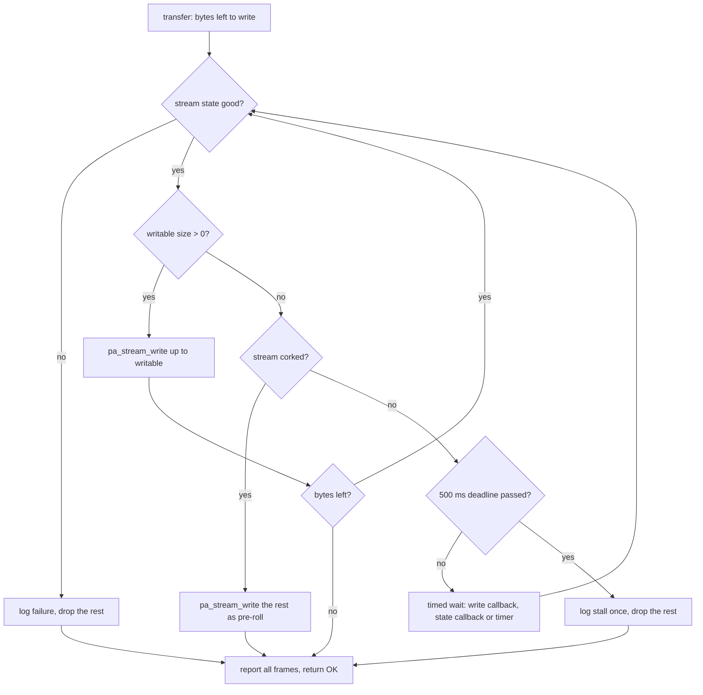
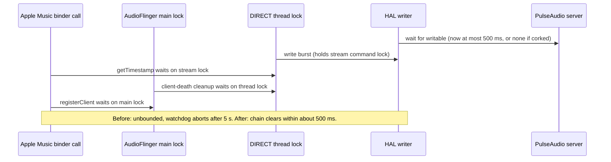

# Pulse Audio HAL Stall Fix - Plan

**Target repos:**
- This repo (`waydroid-hires-x86`) holds the patch, the built APEX overlay, the check script and the docs.
- WayDroid-ATV `android_hardware_interfaces`, branch `lineage-24.0`, checked out at `hardware/interfaces` in the LineageOS 24 tree on the build machine (`~/los24`). HAL source paths below that start with `audio/aidl/default/` are relative to `hardware/interfaces`.

---

## Goal Capsule

- **Objective:** Apple Music on Waydroid keeps playing through pauses, seeks, track skips and short host audio hiccups. A stalled PulseAudio stream costs at most a short gap in sound and never kills `audioserver`, so no app is left unable to play until it is force-stopped.
- **Means:** bound every wait the Pulse backend of the AIDL audio HAL makes on the PulseAudio server, and never wait on a corked stream (KTD2 to KTD6). Ship the fixed HAL as an overlaid vendor APEX (KTD7).
- **Authority:** the R-IDs come first, then the KTDs, then the units.
- **Execution profile:** one PR to this repo, holding the patch file, the built APEX, the check script and the docs. The HAL change itself is applied and built in the LineageOS tree on the build machine, which is not a git remote of this repo.
- **Stop conditions:**
  - Stop and report if Waydroid's apexd refuses the overlaid APEX (U3). Ask before falling back to a full `vendorimage` rebuild.
  - Stop and report if the patched HAL is installed and the U4 checks still show an `audioserver` watchdog abort. The stall then lives somewhere this plan does not touch.
  - Stop and report if normal playback (no pause, no stall) gains gaps or underruns with the patched HAL.
- **Who finishes:** an agent can write the patch, the script and the docs here, but cannot compile them, because the tree is on the build machine. The user applies the patch, builds the APEX, installs it and runs the checks.

---

## Product Contract

### Summary

Change the Pulse backend in WayDroid-ATV's audio HAL so that a playback write never waits on a corked stream, and every other wait on the PulseAudio server gives up after a fixed limit, well under the 5 s `audioserver` watchdog. When a write gives up, the HAL drops that buffer and reports it as played, so AudioFlinger keeps running. Build the HAL's APEX from the existing LineageOS 24 tree, install it through the Waydroid overlay with a one-step rollback, and keep the change as a patch that could go upstream.

### Problem Frame

On 2026-11-10 at 11:38 `audioserver` was killed by its own watchdog (`TimeCheck timeout for IAudioFlinger::registerClient`). The tombstones show a chain. The HAL's PulseAudio writer was blocked in `pa_threaded_mainloop_wait` inside `StreamPulse::transfer`, waiting for the server to ask for more data. AudioFlinger's DIRECT thread was blocked in that write while holding the HAL stream's command lock. Apple Music's `getTimestamp` call held the DIRECT thread's lock while it waited for that stream lock. A binder-death cleanup held AudioFlinger's main lock while it waited for the thread lock. Apple Music's `registerClient` then waited on the main lock for 5 s, and the watchdog fired.

`audioserver` restarted, but Apple Music kept a broken connection and failed every later track (`getMinBufferSize(): error querying hardware`) until it was force-stopped. To the user this looked like tracks sometimes not playing.

The HAL source explains why the wait never ends. `StreamPulse::pause()` and `standby()` cork the PulseAudio stream. The AIDL stream worker (`audio/aidl/default/Stream.cpp`, `StreamOutWorkerLogic::cycle`) passes a write that arrives in the `STANDBY` or `PAUSED` state straight to `transfer()`, without calling `start()` first. A corked PulseAudio stream takes about one target latency of data (the default is 21 ms) and then asks for no more. Any larger write then loops on `pa_stream_writable_size() == 0` with no timeout. A seek on a DIRECT output (pause, flush, write new data, resume) fits that pattern, which is a likely reason the DIRECT path hit it. A host-side stall of an uncorked stream would block the same way on any output.

### Requirements

**Stall safety**
- R1. A playback write to a corked PulseAudio stream returns without waiting on the server.
- R2. No wait on the PulseAudio server in the HAL's stream path lasts longer than a fixed limit that stays under the `audioserver` watchdog (3 s plus 2 s). This covers the playback write, the context-connect and stream-connect waits, and the pause, start, flush, drain and gain operations.
- R3. When a playback write hits its limit, the HAL drops the rest of that buffer, logs the stall and reports success. When the server starts asking for data again, playback continues on the same stream.
- R4. When the PulseAudio stream has failed or been terminated, a write stops waiting at once.

**Behavior kept**
- R5. Normal playback is unchanged on both the mixer and the DIRECT outputs, at every rate the policy XML offers: no new gaps, no new underruns and the same latency.
- R6. Pause, resume, seek and track changes still play correctly. Audio written while paused is still played on resume when it fits the server's buffer.

**Delivery**
- R7. The fixed HAL installs through the Waydroid overlay next to the current `audioserver` and policy XML overlays. Deleting one overlay file restores the stock HAL.
- R8. The change is kept in this repo as a patch against WayDroid-ATV `android_hardware_interfaces` `lineage-24.0`, formatted so it can be sent upstream as-is.
- R9. The repo docs explain how to build, install, check and roll back the fixed HAL, and the README's known limits describe the stall and the fix.

### Key Decisions

- **Fix the HAL, not the trigger.** (session-settled: user-directed — chosen over turning off the DIRECT path or tuning PipeWire on the host: the hang is an unbounded wait in the HAL, so working around the trigger leaves the same crash reachable from any stall.) Governs R1, R2, R3, R4.
- **Drop audio on a stall instead of failing the stream.** A short gap is better than AudioFlinger tearing down and reopening the output. Governs R3.

### Success Criteria

- With the patched HAL, a 15-minute run of pause, play, seek and next-track commands on a hi-res Apple Music track sent to DIRECT ends with the same `audioserver` pid it started with and no new `audioserver` tombstone.
- A host-side stall of 10 s while a track plays (sink suspended) ends with the same `audioserver` pid, and the track plays on by itself within about 1 s after the sink resumes.

### Scope Boundaries

- No change to AudioFlinger, `audioserver` or the DIRECT-for-UID patch.
- No attempt to make Apple Music recover by itself after an `audioserver` restart. That behavior is in Apple Music's closed code, and with this fix the restart should no longer happen.
- No change to host PipeWire or WirePlumber settings.
- No change to the HAL's recording path. Its read loop uses its own pipe with a 1 ms sleep, and the recording path was not part of the crash.
- Not built: a property to tune the stall limit. A fixed constant covers the need. Revisit only if U4 shows real streams that need a longer wait.
- Not built: making the HAL uncork a stream when a write arrives while paused. That would play audio the app asked to pause.
- Not built: reconnecting to PulseAudio after the host's server restarts. `Context::init` connects once per HAL process (`std::call_once`) and gives up for good on a dead context, so after a `pipewire-pulse` restart Waydroid stays silent until the session is restarted. That is already true today, and the 11:38 crash did not involve it. Revisit if host audio server restarts turn out to be common.

#### Deferred to Follow-Up Work

- Opening a PR against WayDroid-ATV `android_hardware_interfaces` with the R8 patch. That is the user's call once U4 passes.

---

## Planning Contract

### Key Technical Decisions

- KTD1. **The fix lives in the Pulse backend, `audio/aidl/default/pulse/`.** Files: `StreamPulse.cpp` for the stream waits and `Context.cpp`/`Context.h` for the shared operation timeout and a timed-wait helper. (session-settled: user-directed — chosen over disabling the DIRECT path or host PipeWire changes: those only avoid one trigger.) Governs R1 to R4.
- KTD2. **A timed wait uses a libpulse timer event that signals the threaded mainloop.** The helper arms a one-shot timer on the context (`pa_context_rttime_new`) that calls `pa_threaded_mainloop_signal`. It waits with `pa_threaded_mainloop_wait`, re-checks its condition and the deadline on every wake-up, and frees the timer before returning. `pa_threaded_mainloop` has no timed wait of its own. Rejected: unlocking and polling with `usleep`, which adds wake-ups and timing jitter to every write.
- KTD3. **A write to a corked stream does not wait.** When `pa_stream_is_corked()` is true and the writable size is 0, the write sends the buffer with `pa_stream_write` anyway and reports it consumed. PulseAudio allows writing past the requested amount and keeps it as pre-roll up to the stream's `maxlength`. Anything past that is dropped by the server as an overrun. This keeps R6 for small pre-rolls and makes R1 true for any size. Rejected: dropping the data outright, which would lose audio the app expects to hear on resume.
- KTD4. **An uncorked stall gives up after 500 ms per write call.** The write then drops the rest of its buffer, reports the full frame count and logs one warning per stall episode, not per write. Reporting the full count keeps `StreamPrimaryPulse::transfer`'s real-time pacing and the worker's frame position consistent. 500 ms is about 25 times the default 21 ms latency, so a healthy stream never reaches it, and it sits far under the 3 s watchdog. Rejected: returning a short count, which makes AudioFlinger retry right away while still holding its thread lock. Also rejected: returning an error, which puts the AIDL stream into the `ERROR` state and forces an output reopen.
- KTD5. **A stream in a state that is not good stops the wait and keeps today's result.** When `PA_STREAM_IS_GOOD(pa_stream_get_state())` is false before or during the wait, the write logs the failure, drops the rest of the buffer and reports it consumed, as a failed `pa_stream_write` already does today. Rejected: returning an error. The stream's context cannot reconnect (see Scope Boundaries), so an AIDL `ERROR` state would only trade silence for repeated failed reopens.
- KTD6. **The connect waits and the shared operation timeout drop to 2 s.** `Context::init()`'s wait for the context to become ready and `StreamPulse::init()`'s wait for the stream to leave `PA_STREAM_CREATING` each get a 2 s deadline through the KTD2 helper. On expiry the existing failure paths run unchanged: the context is reset, or the stream counts as not ready (`NO_INIT`). `Context::waitForOperation` and `waitForStreamOperation` (pause, start, flush, drain, gain) go from 5 s to 2 s, which stays under the 3 s watchdog for calls made inside a binder transaction. Rejected: keeping 5 s, because a 5 s HAL wait inside a binder call can trigger the same watchdog abort.
- KTD7. **The fixed HAL ships as a replacement `com.android.hardware.audio.apex`.** The stock image ships the HAL as `/vendor/apex/com.android.hardware.audio.apex` inside `vendor.img`, so the overlay replaces that whole APEX at `vendor/apex/com.android.hardware.audio.apex`. The APEX bundles its own libraries and talks to `audioserver` over the stable AIDL interface, so it carries less build-mismatch risk than the overlaid `audioserver`. If apexd refuses an overlaid vendor APEX, the fallback is a `vendorimage` built from the same tree, installed with `waydroid init -f`. That needs the user's approval under the Goal Capsule stop conditions.
- KTD8. **Build from a `hardware/interfaces` that already has the Pulse backend.** The backend landed on `lineage-24.0` on 2026-09-24 (`cd8baed1c9`, then `6318ed4532` and `f35bda6bc4`), and no later commit touches `audio/aidl/default` as of 2026-11-10. The May 2026 tree on the build machine predates it. Sync only `hardware/interfaces` to the current `lineage-24.0` head and apply the patch on top. A full sync would also move `frameworks/av` and its applied DIRECT patch, which this fix does not need.
- KTD9. **The patch is a `git format-patch` file in `patches/hardware_interfaces/`.** That mirrors `patches/frameworks_av/` and can be sent upstream as-is (R8).

### High-Level Technical Design

How a playback write behaves after the fix (KTD3, KTD4, KTD5):

Why the bound breaks the 11:38 deadlock chain: each lock in the chain is now held for at most one bounded HAL write.

### Implementation Constraints

- The HAL code must keep the existing locking model: every libpulse call runs inside `Context::withLock`, and callbacks only signal the mainloop.
- No new properties, flags or Android.bp modules. The change touches only existing files in `audio/aidl/default/pulse/`.

---

## Implementation Units

### U1. Stall check script

- **Goal:** A host-side script that drives pause, play, seek and next-track on the running Waydroid session and reports whether `audioserver` survived. It gives a before-and-after baseline for R1 to R6.
- **Requirements:** Success Criteria; supports R5, R6.
- **Dependencies:** none.
- **Files:** `scripts/check-audio-stall.sh` (new).
- **Approach:**
  1. Record `audioserver`'s pid and the newest tombstone name through `waydroid shell` (the script needs `sudo`, as the existing docs do).
  2. Loop for a set duration, sending media commands to the active session (`cmd media_session dispatch` with pause, play, next and previous, plus a seek by key event where supported) at irregular short intervals.
  3. Optionally run a host stall: suspend the default PulseAudio/PipeWire sink for a set time with `pactl suspend-sink`, then resume it.
  4. At the end, compare the pid and the tombstones, grep logcat for `TimeCheck timeout` and `AHAL_StreamPulse` stall warnings, and print PASS or FAIL with the evidence lines.
- **Execution note:** run it once against the stock HAL before U2 lands, to record whether the hang reproduces. A repro is useful but not required, since the fix guards every stall and not only the corked case.
- **Patterns to follow:** the command style in `docs/build-libaudioflinger.md` section 6 (`sudo waydroid shell -- ...`, `waydroid prop set`).
- **Test scenarios:**
  - Happy path: a 2-minute run with nothing crashing prints PASS and the unchanged pid.
  - Error path: killing `audioserver` by hand during a run (`killall audioserver` in the container) makes the script print FAIL and name the new pid.
  - Error path: a run that starts with Waydroid stopped exits with a clear message instead of a false PASS.
  - Edge case: with the stall step on, the sink is resumed even if the script is interrupted with Ctrl-C (trap on exit).
- **Verification:** both error scenarios print FAIL, and a quiet run prints PASS.

### U2. Bounded waits in the Pulse backend

- **Goal:** The HAL never waits on a corked stream and never waits on the PulseAudio server past a fixed limit.
- **Requirements:** R1, R2, R3, R4, R6; KTD1 to KTD6.
- **Dependencies:** none (U1 only supplies the baseline).
- **Files:**
  - `audio/aidl/default/pulse/StreamPulse.cpp` (modify, in `hardware/interfaces`)
  - `audio/aidl/default/pulse/Context.cpp` and `audio/aidl/default/pulse/Context.h` (modify)
  - `patches/hardware_interfaces/0001-audio-pulse-bound-stream-waits.patch` (new, in this repo)
- **Approach:**
  1. Add the KTD2 timed-wait helper to `Context`. It takes a deadline and a condition, and it must be called with the mainloop lock held.
  2. Rewrite the write loop in `StreamPulse::transfer` per the High-Level Technical Design flowchart (KTD3, KTD4, KTD5). Keep the existing `pa_stream_write` error path.
  3. Bound the context-ready wait in `Context::init` and the `PA_STREAM_CREATING` wait in `StreamPulse::init` with the helper (KTD6).
  4. Lower the operation timeout in `Context::waitForOperation` and `waitForStreamOperation` to 2 s (KTD6).
  5. Commit the change on top of `lineage-24.0` in `hardware/interfaces` and export it with `git format-patch` into this repo (KTD9).
- **Technical design:** directional only. The helper's loop is "while the condition is false and now is before the deadline: arm the timer if it is not armed, then wait", and it returns whether the condition became true.
- **Patterns to follow:** `Context::waitForStreamOperation`, which already gives up after a fixed time and cancels its operation. Use `LOG(WARNING)` with the existing `AHAL_StreamPulse` tag.
- **Test scenarios:** the HAL has no unit-test seam that runs without a PulseAudio server, so these run on the device in U4 through U1's script and logcat. That catches real behavior against PipeWire. It cannot isolate timing edge cases.
  - Covers R1: seeking a hi-res DIRECT track 50 times produces no `audioserver` restart, and logcat shows no write longer than 500 ms on a corked stream.
  - Covers R3: suspending the host sink for 10 s during playback logs one stall warning per episode, `audioserver` keeps its pid, and the track plays on within about 1 s of resuming the sink.
  - Covers R4: restarting the host's `pipewire-pulse` during playback logs a stream failure, `audioserver` keeps its pid and no write blocks. Sound comes back after a Waydroid session restart, the documented limit in Scope Boundaries.
  - Covers R6: pause for 30 s, then resume. Playback continues from the same position with no audible repeat.
  - Covers R5: 10 minutes of uninterrupted playback at 44.1 kHz/16-bit through the mixer and at 96 kHz float through DIRECT logs no stall warnings and no new underruns in `dumpsys media.audio_flinger`.
- **Verification:** the patch applies cleanly with `git am` on a fresh `lineage-24.0` checkout of `hardware/interfaces`, and the U3 build compiles it with no new warnings.

### U3. Build and package the fixed APEX

- **Goal:** A built `com.android.hardware.audio.apex` with the U2 patch, placed in this repo's overlay, plus a guide to rebuild it.
- **Requirements:** R7, R8, R9; KTD7, KTD8.
- **Dependencies:** U2.
- **Files:**
  - `overlay/vendor/apex/com.android.hardware.audio.apex` (new, a built binary like `overlay/system/bin/audioserver`)
  - `docs/build-audio-hal.md` (new)
- **Approach:**
  1. On the build machine, sync only `hardware/interfaces` to the `lineage-24.0` head (KTD8). Confirm `audio/aidl/default/pulse/StreamPulse.cpp` exists, then apply the U2 patch.
  2. Build the APEX module with the same `lunch` target as `docs/build-libaudioflinger.md` section 4, and copy the output APEX into `overlay/vendor/apex/`.
  3. Write `docs/build-audio-hal.md` in the same shape as `docs/build-libaudioflinger.md`: before you start, sync, apply, build, install, check, roll back, and the `vendorimage` fallback.
- **Execution note:** this is packaging. Prove it with an install-and-boot smoke check, not with unit tests.
- **Patterns to follow:** `docs/build-libaudioflinger.md` for structure, commands and the rollback section. The `strings` check in its section 5 for proving the right binary was built.
- **Test scenarios:**
  - Happy path: the built APEX's HAL binary contains the new stall warning string.
  - Edge case: the output APEX file is under GitHub's 100 MB file limit (the stock one is about 71 MB).
- **Verification:** the APEX exists at the overlay path, and the guide's steps reproduce it from a clean sync.

### U4. Install, check and document

- **Goal:** The fixed HAL runs on the user's Waydroid, the success criteria are met, and the README tells future readers what changed.
- **Requirements:** R5, R6, R7, R9; Success Criteria.
- **Dependencies:** U1, U3.
- **Files:**
  - `README.md` (modify: the "What is in this repo" table, Install, Known limits)
  - `docs/build-audio-hal.md` (modify: record the observed results, as `docs/build-libaudioflinger.md` does under its results section)
- **Approach:**
  1. Copy the APEX to `/var/lib/waydroid/overlay/vendor/apex/` and restart the container. This is the KTD7 gate: confirm `/apex/com.android.hardware.audio` is active and that its HAL binary is the new one. If apexd refuses it, stop per the Goal Capsule.
  2. Run U1's script for the two success-criteria runs and the U2 device scenarios.
  3. Update the README with the new overlay file, the install step and known-limits lines for the stall fix and its remaining limits: a stall still costs a gap of up to 500 ms, and a host `pipewire-pulse` restart needs a Waydroid session restart.
  4. Confirm rollback: delete the overlay APEX, restart and check that the stock HAL is active again.
- **Test scenarios:** Test expectation: none -- this unit runs the U2 device scenarios and checks installation, and adds no behavior of its own.
- **Verification:** both success-criteria runs print PASS, rollback restores the stock APEX, and the README lists the new overlay file.

---

## Verification Contract

| Gate | How | Proves |
|---|---|---|
| Patch applies | `git am` of `patches/hardware_interfaces/0001-audio-pulse-bound-stream-waits.patch` on a fresh `hardware/interfaces` `lineage-24.0` checkout | R8 |
| Build | the APEX module builds under `lineage_waydroid_x86_64_only-cp2a-userdebug` (per `docs/build-libaudioflinger.md` section 4) with no new warnings | U2, U3 |
| Right binary | `strings` on the HAL binary inside the installed APEX shows the new stall warning text | R7 |
| APEX active | `/apex/com.android.hardware.audio` is mounted from the overlaid APEX after a container restart | R7, KTD7 |
| Stress run | `scripts/check-audio-stall.sh`: 15 minutes of pause, play, seek and next on a DIRECT hi-res track prints PASS | R1, R6, Success Criteria |
| Host stall | `scripts/check-audio-stall.sh` with a 10 s sink suspend prints PASS, and playback resumes on its own | R2, R3, Success Criteria |
| Normal playback | 10 minutes each on the mixer and DIRECT outputs with no stall warnings and no new underruns | R5 |
| Rollback | deleting the overlay APEX restores the stock HAL | R7 |

---

## Definition of Done

- Every Verification Contract gate passes on the user's Waydroid, with the results recorded in `docs/build-audio-hal.md`.
- The repo holds the patch, the built APEX, the check script, the new guide and the README update.
- No debugging leftovers stay in the HAL patch (extra logging, test constants, commented-out code), and no abandoned approaches stay in the diff.
- Per unit: U1 prints FAIL for both error scenarios. U2's patch applies cleanly. U3's APEX contains the new string. U4's rollback works.

---

## Risks & Dependencies

- **The build machine and tree.** Only the 32 GB machine can build. Its `~/los24` tree is from May 2026 and needs the KTD8 sync first.
- **apexd and overlaid vendor APEXes.** Unverified on Waydroid. U4's first step is the gate, and KTD7 names the fallback.
- **Pre-roll larger than `maxlength` while corked.** KTD3 relies on PulseAudio dropping excess pre-roll as an overrun instead of failing the stream. If a long pause plus a large flush-and-refill shows a failed stream in U4, the corked branch should keep only what fits and drop the rest.
- **The trigger is inferred.** The logs before 11:38:20 were not checked for a pause or seek. U1's baseline run may confirm it, and the fix does not depend on it.

---

## Sources

- Tombstones `tombstone_47` to `tombstone_49` from 2026-11-10 11:38. They were copied from the container to the session scratch area and are not kept in the repo. They show the lock chain and the HAL writer blocked in `StreamPulse::transfer`.
- `audio/aidl/default/pulse/StreamPulse.cpp` (`transfer`, `init`, `pause`, `standby`) and `audio/aidl/default/pulse/Context.cpp` (`waitForOperation`, `waitForStreamOperation`) on WayDroid-ATV `android_hardware_interfaces` `lineage-24.0`.
- `audio/aidl/default/Stream.cpp`, `StreamOutWorkerLogic::cycle` (`burst` in `STANDBY`/`PAUSED`) and `StreamOutWorkerLogic::write`, on the same branch.
- `docs/build-libaudioflinger.md` for the build tree, `lunch` target and overlay conventions.
